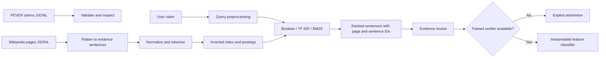

# FEVER: An Evidence-Based Information Retrieval System for Automated Fact Verification

## Abstract

This project explores sentence retrieval from Wikipedia as the first stage of automated claim verification. It includes robust FEVER-style JSONL readers, conservative text normalization, a persistent inverted index, Boolean search, TF-IDF/cosine search, Okapi BM25, FEVER evidence-aware retrieval metrics, and a Streamlit evidence explorer. Without a trained model it abstains with **NOT ENOUGH INFO**; an optional interpretable logistic-regression baseline can be trained on FEVER training claims. Lexical relevance alone is never treated as entailment.

## Problem, motivation, and objectives

Given a natural-language claim, retrieve source sentences and determine whether the available evidence supports, refutes, or leaves it unresolved. The project emphasizes indexing, query processing, ranking, and evidence evaluation. Research questions include how BM25 compares with TF-IDF for sentence retrieval; how top-k affects evidence coverage; and how retrieval failures affect downstream verification.

## Scope and limitations

The implemented lexical IR path is local and does not require a transformer model. No full Wikipedia dump, FEVER results, or trained model is bundled. A ranking score measures textual relevance only. `NOT ENOUGH INFO` means the system could not establish a verdict from its available evidence; it does not imply a claim is false.

## Dataset and provenance

Use the official FEVER claims and Wikipedia sentence corpus from the [FEVER project](https://fever.ai/dataset/fever.html) and [official GitHub repository](https://github.com/awslabs/fever). Read the dataset terms and citation information at the source. Place downloaded JSONL files under `data/raw/`; keep them out of Git. The wiki page collection is large, so it is not downloaded automatically. `data/sample/` contains tiny illustrative records for smoke checks only; these are not FEVER data and must not be used to report academic results.

## Requirements and setup

Python 3.11 or 3.12 is recommended. From this directory:

```bash
python3 -m venv .venv
source .venv/bin/activate       # Windows: .venv\\Scripts\\activate
python -m pip install --upgrade pip
pip install -r requirements.txt
```

The application and lexical index do not require paid APIs or transformer downloads. Optional semantic retrieval may use `sentence-transformers` and FAISS after separately installing compatible packages and downloading a model.

## Architecture and data flow



## Algorithms

- **Boolean** performs set operations over postings; it is useful for exact term constraints but does not rank.
- **TF-IDF with cosine similarity** weights terms by corpus rarity and ranks vector similarity. It currently builds vectors for the supplied records at query time, so it is best for samples/smaller collections.
- **BM25** uses term frequency, inverse document frequency, and document-length normalization over postings. It avoids scanning every sentence for candidates.
- **Semantic retrieval** is not implemented yet. It is a useful extension, but should be added as a separately evaluated optional retriever alongside the lexical baselines.
- Retrieval is not verification: similarity alone cannot establish whether a sentence entails or contradicts a claim.

## Data preparation and commands

Put official files in `data/raw/` yourself, observing FEVER terms. The expected claims format is one JSON object per line with `id`, `claim`, `label`, and `evidence`. The wiki format is one page object per line with `title` (or `id`) and `lines`, where each sentence is `sentence_id<TAB>sentence text`.

```bash
python -m scripts.prepare_data data/raw/train.jsonl
python -m scripts.build_index data/raw/wiki-pages.jsonl --limit 100000
python -m scripts.train_model --train data/raw/train.jsonl --index artifacts/indexes/fever_index.json
python -m scripts.run_evaluation --dev data/raw/dev.jsonl --index artifacts/indexes/fever_index.json
python -m scripts.run_retrieval_evaluation --claims data/raw/dev.jsonl --index artifacts/indexes/fever_index.json --top-k 5
streamlit run app.py
```

Omit `--limit` only when you have enough disk and memory for the complete corpus. The index is saved to `artifacts/indexes/fever_index.json` and reloaded by the app. For a sample-only smoke index, `python -c 'from src.data.load_data import read_jsonl; from src.indexing.inverted_index import InvertedIndex; i=InvertedIndex(); [i.add(r) for r in read_jsonl("data/sample/evidence.jsonl")]; i.save("artifacts/indexes/fever_index.json")'`.

## Training and evaluation status

The supervised baseline is an interpretable logistic regression over claim coverage, token Jaccard overlap, negation agreement, number agreement, evidence count, and scaled BM25 score. It trains only on labels in the provided training JSONL and saves a model plus metadata. Evaluation is a separate command for a labeled development JSONL split. This is a deliberately simple baseline, not a modern textual-entailment model. Training on the illustrative sample is not appropriate and no official data results have been computed here. Use train for fitting, development for model selection, and reserve test labels.

Retrieval evaluation computes Precision@K, Recall@K, MRR, nDCG@K, mean latency, and evidence-set completeness against FEVER sentence IDs. Sentence relevance is measured against the union of acceptable evidence; completeness requires all evidence sentences from at least one acceptable group. Verification evaluation reports accuracy, macro/per-class precision/recall/F1, confusion matrix, and FEVER score. Index construction saves sentence count, vocabulary size, build time, and serialized size. No metrics are displayed in the UI as though they had been measured.

## Testing

```bash
pytest
```

The test suite covers tokenization, duplicate handling, JSONL recovery, Boolean and BM25 retrieval, abstention, label mapping, retrieval metrics, acceptable FEVER evidence groups, and FEVER score logic. It does not validate full-corpus performance or statistical significance.

## Documentation

See `docs/architecture.md`, `docs/methodology.md`, `docs/experiments.md`, `docs/user_guide.md`, `docs/limitations.md`, `docs/academic_report_outline.md`, and `docs/viva_questions.md`.

## References

Thorne, J., Vlachos, A., Christodoulopoulos, C., & Mittal, A. (2018). *FEVER: a Large-scale Dataset for Fact Extraction and VERification*. NAACL-HLT. [ACL Anthology](https://aclanthology.org/N18-1074/). See the official [FEVER dataset page](https://fever.ai/dataset/fever.html) for data and usage details.

## Current implementation status

Implemented: data readers/validation summary, streaming wiki sentence preparation, preprocessing, inverted index persistence and build metadata, Boolean/TF-IDF/BM25 retrieval, a trainable supervised baseline, development classification and FEVER-score evaluation, BM25 evidence retrieval evaluation, conservative abstention when no model exists, an evidence-focused Streamlit interface, dataset and evaluation views, and academic documentation. Not implemented: a separate modern NLI model, semantic retrieval, probability calibration, rich error analysis, or full-corpus performance results. The reported FEVER-style score uses the standard label-plus-evidence criterion; compare with the official scorer before formal publication.
