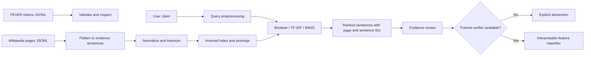

# FEVER: An Evidence-Based Information Retrieval System for Automated Fact Verification

## Abstract

This project explores sentence retrieval from Wikipedia as the first stage of automated claim verification. It includes robust FEVER-style JSONL readers, conservative text normalization, a persistent inverted index, Boolean search, TF-IDF/cosine search, Okapi BM25, FEVER evidence-aware retrieval metrics, and a Streamlit evidence explorer. Without a trained model it abstains with **NOT ENOUGH INFO**; an optional interpretable logistic-regression baseline can be trained on FEVER training claims. Lexical relevance alone is never treated as entailment.

## Problem, motivation, and objectives

Given a natural-language claim, retrieve source sentences and determine whether the available evidence supports, refutes, or leaves it unresolved. The project emphasizes indexing, query processing, ranking, and evidence evaluation. Research questions include how BM25 compares with TF-IDF for sentence retrieval; how top-k affects evidence coverage; and how retrieval failures affect downstream verification.

## Scope and limitations

The implemented lexical IR path is local and does not require a transformer model. No full Wikipedia dump, FEVER results, or trained model is bundled. A small FEVER-derived preview index can be included for deployment; it is not a replacement for the full corpus. A ranking score measures textual relevance only. `NOT ENOUGH INFO` means the system could not establish a verdict from its available evidence; it does not imply a claim is false.

## Dataset and provenance

Use the official FEVER claims and Wikipedia sentence corpus from the [FEVER project](https://fever.ai/dataset/fever.html) and [official GitHub repository](https://github.com/awslabs/fever). Read the dataset terms and citation information at the source. Place downloaded JSONL files under `data/raw/`; keep them out of Git. The full wiki page collection is large, so it is not downloaded automatically. `data/sample/` contains tiny illustrative records for smoke checks only; these are not FEVER data and must not be used to report academic results.

## Requirements and setup

Python 3.11 or 3.12 is recommended. From this directory:

```bash
python3 -m venv .venv
source .venv/bin/activate       # Windows: .venv\\Scripts\\activate
python -m pip install --upgrade pip
pip install -r requirements.txt
```

The lexical methods run locally. Sentence-embedding retrieval uses `sentence-transformers/all-MiniLM-L6-v2`; its model files download the first time the feature is used. Porter stemming is provided by NLTK and requires no separate language-data download.

## Architecture and data flow



## Algorithms

- **Boolean** performs set operations over postings; it is useful for exact term constraints but does not rank.
- **TF-IDF with cosine similarity** weights terms by corpus rarity and ranks vectors fitted over the complete loaded corpus.
- **BM25** uses term frequency, inverse document frequency, and document-length normalization over postings. It avoids scanning every sentence for candidates.
- **Sentence embeddings** rank dense MiniLM sentence vectors by cosine similarity.
- **Hybrid RRF** combines BM25, TF-IDF, and sentence-embedding ranks with reciprocal-rank fusion.
- Retrieval is not verification: similarity alone cannot establish whether a sentence entails or contradicts a claim.

## Data preparation and commands

Put official files in `data/raw/` yourself, observing FEVER terms. The expected claims format is one JSON object per line with `id`, `claim`, `label`, and `evidence`. The wiki format is one page object per line with `title` (or `id`) and `lines`, where each sentence is `sentence_id<TAB>sentence text`.

```bash
python -m scripts.prepare_data data/raw/train.jsonl
python -m scripts.build_sqlite_index data/raw/wiki-pages
python -m scripts.train_model --train data/raw/train.jsonl --index artifacts/indexes/fever_index.json
python -m scripts.run_evaluation --dev data/raw/dev.jsonl --index artifacts/indexes/fever_index.json
python -m scripts.run_retrieval_evaluation --claims data/raw/dev.jsonl --index artifacts/indexes/fever_index.json --top-k 10
streamlit run app.py
```

The required preprocessing variants can be selected at index-build time; the saved settings are reused for lexical query processing. Rebuild the matching index whenever these options change:

```bash
python -m scripts.build_sqlite_index data/raw/wiki-pages --output artifacts/indexes/fever_index.sqlite3 --remove-stopwords --stemming
```

Stop-word removal retains negation terms (`no`, `not`, `never`, `nor`). The retrieval evaluation command compares BM25, TF-IDF, sentence embeddings, and Hybrid RRF at @10, reports Precision@10, Recall@10, MAP@10, nDCG@10, MRR and evidence-set completeness, and breaks out scores for any domain labels in the claims file. The dashboard expects a `domain` field by default; use `--domain-field` to select the actual field in your data.

For the full Wikipedia corpus, use `scripts.build_sqlite_index`: it streams one or more JSONL files into a disk-backed SQLite FTS5 index, so it does not keep the complete corpus in Python memory. The app automatically prefers `artifacts/indexes/fever_index.sqlite3` when it exists. Add `--limit 100000` for a small preview; omit the limit to process every sentence in the extracted corpus. Full indexing can take a long time and use substantial disk space. The older JSON builder remains available for small experiments and the training/evaluation scripts. After building, refresh the app. For a sample-only smoke index, `python -c 'from src.data.load_data import read_jsonl; from src.indexing.inverted_index import InvertedIndex; i=InvertedIndex(); [i.add(r) for r in read_jsonl("data/sample/evidence.jsonl")]; i.save("artifacts/indexes/fever_index.json")'`.

## Deployment

The full SQLite index under `artifacts/indexes/` is intentionally ignored by Git. A clean GitHub checkout therefore needs a small index to run as a useful public preview. After building the full local FEVER index, create a deterministic 100,000-sentence preview index:

```bash
python -m scripts.build_demo_index --source artifacts/indexes/fever_index.sqlite3 --output data/demo/fever_demo.sqlite3 --size 100000
```

Compress the generated database before committing it (`gzip -kf data/demo/fever_demo.sqlite3`) and commit `data/demo/fever_demo.sqlite3.gz` with its `.meta.json` sidecar. The app expands the archive into temporary storage at startup. It prefers the full local index when present, then uses this preview index on a clean deployment. The interface clearly labels the preview and warns that a search can miss evidence outside the sampled sentences. To use another mounted index, set `FEVER_INDEX_PATH` to its path.

The preview is derived from the FEVER June 2017 Wikipedia snapshot. Preserve the article source links shown with retrieved evidence and include the official [FEVER dataset citation and reuse terms](https://fever.ai/dataset/fever.html) when sharing the app. The preview is for demonstrating retrieval only; use the full corpus and official FEVER claim splits for academic evaluation.

## Training and evaluation status

The supervised baseline is an interpretable logistic regression over claim coverage, token Jaccard overlap, negation agreement, number agreement, evidence count, and scaled BM25 score. It trains only on labels in the provided training JSONL and saves a model plus metadata. Evaluation is a separate command for a labeled development JSONL split. This is a deliberately simple baseline, not a modern textual-entailment model. Training on the illustrative sample is not appropriate and no official data results have been computed here. Use train for fitting, development for model selection, and reserve test labels.

Retrieval evaluation compares BM25, TF-IDF, sentence embeddings, and Hybrid RRF using Precision@10, Recall@10, MAP@10, nDCG@10, MRR, latency, and evidence-set completeness against FEVER sentence IDs. Sentence relevance is measured against the union of acceptable evidence; completeness requires all evidence sentences from at least one acceptable group. Per-domain scores are computed only for domain labels actually present. A full 21-domain report requires a labeled split with all 21 domain labels; the dashboard never fills missing rows with fabricated scores. Verification evaluation reports accuracy, macro/per-class precision/recall/F1, confusion matrix, and FEVER score. Index construction saves sentence count, build time, serialized size, and preprocessing settings.

## Testing

```bash
pytest
```

The test suite covers tokenization, duplicate handling, JSONL recovery, Boolean and BM25 retrieval, abstention, label mapping, retrieval metrics, acceptable FEVER evidence groups, and FEVER score logic. It does not validate full-corpus performance or statistical significance.

## Documentation

See `docs/architecture.md`, `docs/methodology.md`, `docs/experiments.md`, `docs/user_guide.md`, `docs/limitations.md`, `docs/academic_report_outline.md`, and `docs/viva_questions.md`.

## References

Thorne, J., Vlachos, A., Christodoulopoulos, C., & Mittal, A. (2018). *FEVER: a Large-scale Dataset for Fact Extraction and VERification*. NAACL-HLT. [ACL Anthology](https://aclanthology.org/N18-1074/). See the official [FEVER dataset page](https://fever.ai/dataset/fever.html) for data and usage details.

## Current implementation status

Implemented: data readers, streaming wiki indexing, configurable text preprocessing, Boolean/TF-IDF/BM25 retrieval, sentence-embedding retrieval, Hybrid RRF, an optional interpretable verifier, classification evaluation, a four-method retrieval benchmark and dashboard, and project documentation. Full benchmark scores still require the official labeled development split and matching full evidence index. The reported FEVER-style score uses the standard label-plus-evidence criterion; compare with the official scorer before formal publication.
